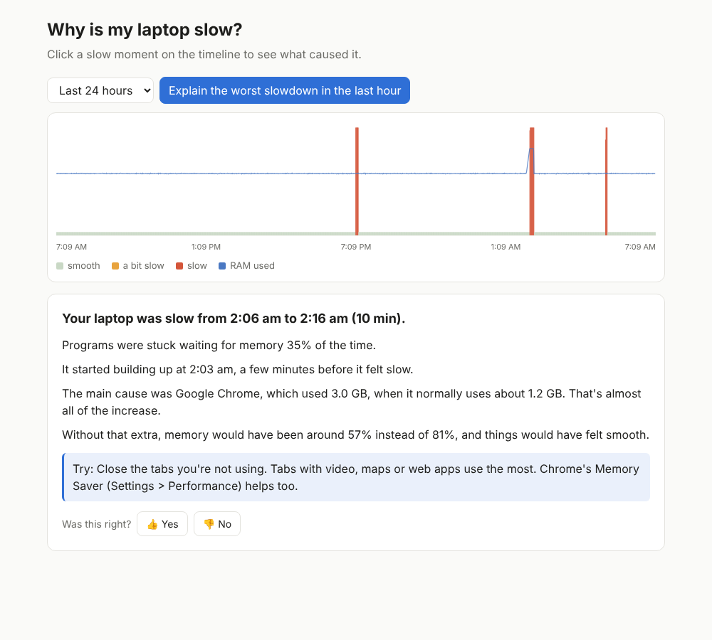

# whyslow

Tells you **why your laptop was slow**, in plain words, and what to do about it.

It quietly records how your laptop is doing every 5 seconds. Later you click a slow
moment on a timeline and it explains what happened:



Runs on Windows and Ubuntu, fully offline. Nothing leaves your laptop, and there's no AI model inside.

## Status

| Part | State |
| --- | --- |
| Collector (snapshots every 5 s) | done |
| Storage (SQLite, 7 days detail + 90 days hourly) | done |
| Analyzer (explains a slow moment) | done |
| Web page (timeline + 👍/👎) | done |
| Start automatically at login | done (`python -m whyslow install`) |
| Tested on a real Windows laptop | done |

## Try it

```bash
python -m venv .venv
# Ubuntu: source .venv/bin/activate     Windows: .venv\Scripts\activate
pip install -e ".[dev]"

python -m whyslow web --demo  # see the page with a fake day of data
python -m whyslow install     # start recording now and at every login (no window)
python -m whyslow collect     # or: record in this window until Ctrl+C
python -m whyslow web         # the page, with your real data
python -m whyslow explain     # same explanation, in the terminal
python -m whyslow status      # how much is stored
pytest                        # run the tests
```

Data is stored in `~/.local/share/whyslow/` on Ubuntu and `%LOCALAPPDATA%\whyslow\` on Windows.

## How it's built

```
whyslow/
  config.py             every setting, each tied to a design decision
  models.py             what a snapshot contains
  collector.py          the 5 s loop, heartbeat probe, batching
  storage.py            SQLite tables, hourly summaries, cleanup, feedback
  analyzer/             score -> slow stretch -> who caused it -> story
  data/known_apps.json  friendly names + tips for background apps
  platforms/
    linux.py            Ubuntu: kernel pressure numbers (PSI), temperature
    windows.py          Windows: hard faults, "Not Responding" check
  web.py                local web server (127.0.0.1 only)
  static/index.html     the timeline page, no outside libraries
  demo.py               a fake day with three slowdowns
  autostart.py          start at login (Windows Startup folder / systemd)
```

The design and the reasons behind each choice are in [docs/DESIGN.md](docs/DESIGN.md).
