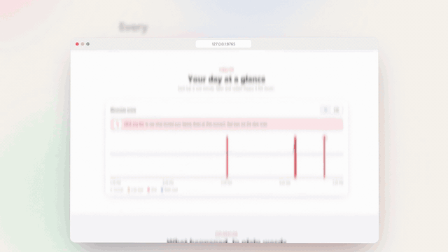

<picture><source media="(prefers-color-scheme: dark)" srcset="docs/logo-inverted.svg"></picture>

<p align="center"></p>

why slow tells you **why your laptop was slow**, in plain words, and what to do about it. It quietly checks your laptop every 5 seconds. Later, you click a slow moment on a timeline, and it tells you what happened, which app caused it, and one thing to try.

Task Manager shows you numbers. why slow tells you the reason: "Google Chrome used 3.0 GB, when it normally uses about 1.2 GB. Without that extra, things would have felt smooth."

## What you can do

- **See your day as a timeline**, one bar per minute. Red bars are the slow ones.
- **Hover a bar** to see how busy the CPU, memory and battery were that minute.
- **Click a bar** to get the story: what the laptop was waiting on, when it started building up, and which app was behind it.
- **Get one thing to try**, like closing tabs or moving a Defender scan to when you're away.
- **Tell it when it's wrong** with 👍 or 👎, so the explanations get better.
- **Ask from the terminal**, like `python -m whyslow explain --at 14:41`.

## Install

why slow runs on Windows 10 or 11 and Ubuntu, with Python 3.10 or later.

```bash
git clone https://github.com/Nandinipatil1410/why-slow.git
cd why-slow
python -m venv .venv
```

Then activate it: `.venv\Scripts\activate` on Windows, or `source .venv/bin/activate` on Ubuntu.

```bash
pip install -e .
python -m whyslow install
```

`install` starts recording now and at every login, with no window. After a few minutes, open the page:

```bash
python -m whyslow web
```

To see it first with a made-up day of data, run `python -m whyslow web --demo`.

## Privacy

why slow never goes online. Everything it records stays in a small database on your laptop, and the page is only reachable from your own computer, at `127.0.0.1`. There's no account and no AI model: every sentence it writes comes from a number it measured.

It's built not to cause the slowness it explains. A check takes about 8 ms of CPU, and it writes to disk once a minute.

## More help

- [Using why slow](docs/using-why-slow.md): the page, the commands, and where your data lives.
- [Questions and problems](docs/questions-and-problems.md): if something doesn't work.
- [How why slow works](docs/how-it-works.md) and [Developing why slow](docs/development.md), for the technical details.
